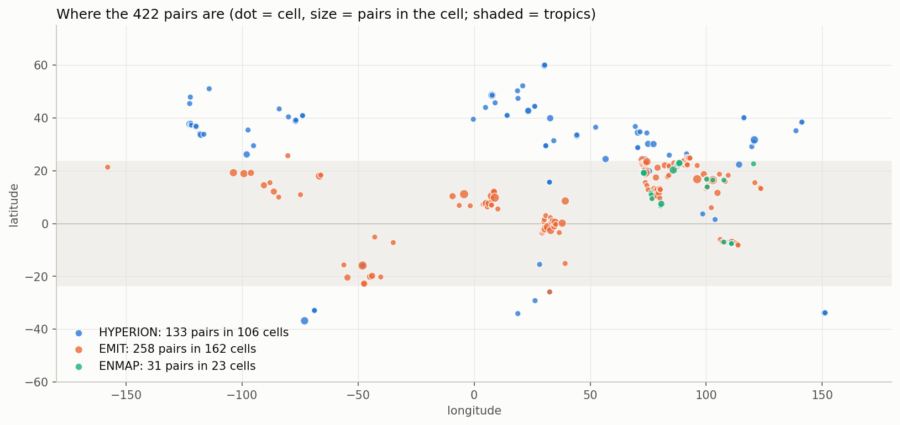
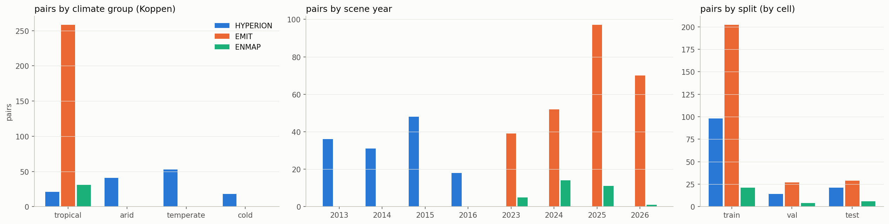
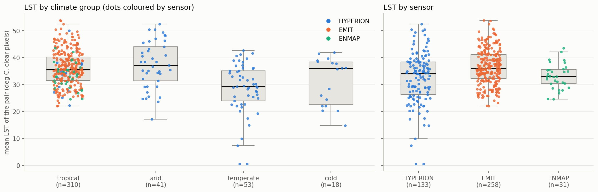
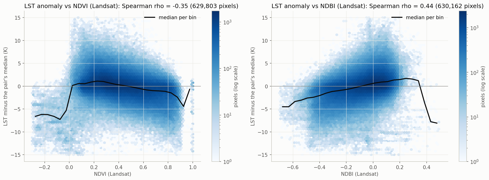
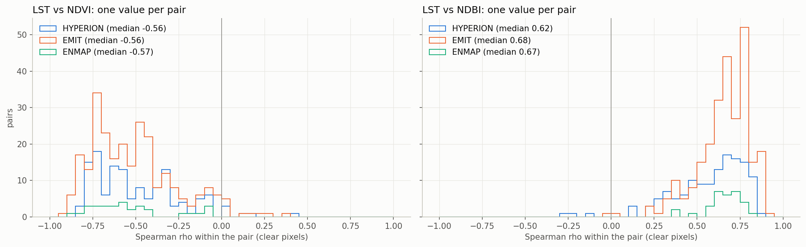
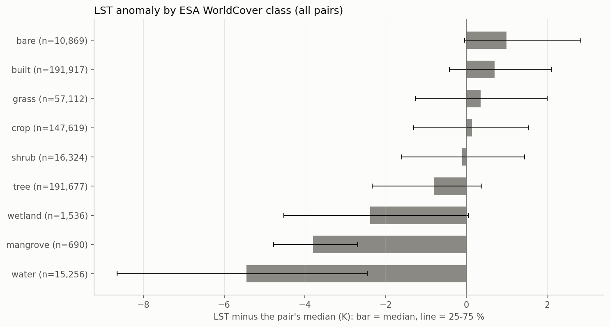
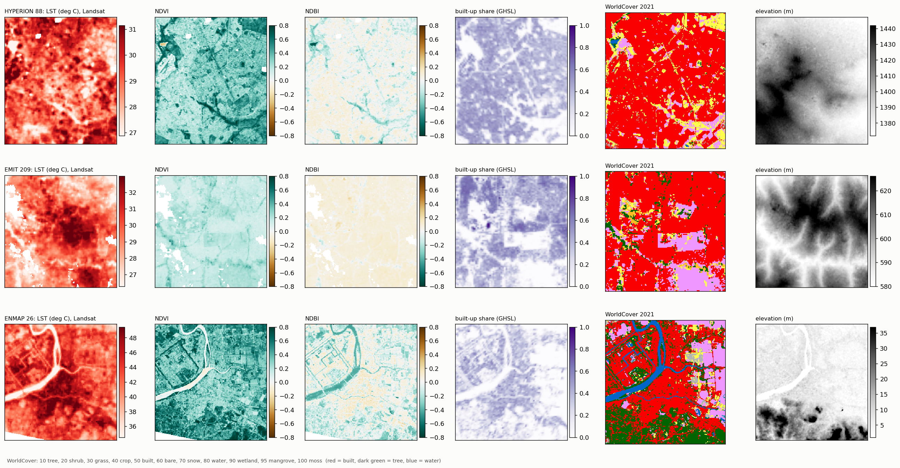

# Member 1 results: the handover dataset

Small files and figures from the dataset. The rasters (about 3.8 GB) stay on Google Drive, shared with the team members only.
Notebooks: [`notebooks/member1/preprocessing/`](../../notebooks/member1/preprocessing/README.md).

## The dataset

| Sensor | Pairs | Locations | Pixel | Bands | Scene years | Landsat partner |
|---|---|---|---|---|---|---|
| EMIT | 258 | 162 | 60 m | 232 | 2023–2026 | Landsat 8 (139) / 9 (119) |
| Hyperion | 133 | 106 | 30 m | 137 | 2013–2016 | Landsat 8 |
| EnMAP | 31 | 23 | 30 m | 177 | 2023–2026 | Landsat 8 (11) / 9 (20) |
| **Total** | **422** | **281** | | | | |

9 locations are covered by more than one sensor. Split by location: train / val / test = 321 / 45 / 56 pairs
(213 / 33 / 35 locations); no location is in two splits. Climate groups: tropical 310 (all EMIT and EnMAP pairs, 21 Hyperion),
temperate 53, arid 41, cold 18 (all Hyperion). Size of the three `PASSED-PAIRS` folders: 3.83 GB.

Each pair folder: `<sensor>_reflectance.tif` (surface reflectance × 10000, int16, nodata −32768), `landsat_<id>.tif`
(blue, green, red, nir, swir1, swir2, LST_K, then QA_PIXEL or clear_frac), `aux_layers.tif` (12 layers) and `pair_info.json`.
Details: [`README_DATASET.txt`](README_DATASET.txt), column meanings: [`dataset_index_columns.csv`](dataset_index_columns.csv).

## Quality control (QC v2.3)

| Sensor | Processed | PASS | Most common failures |
|---|---|---|---|
| Hyperion | 283 | 133 (47 %) | joint coverage 99, NIR ratio 93, agreement 31, haze 25 |
| EMIT | 400 | 258 (65 %) | haze 64, NIR ratio 59, coverage 55, NDVI correlation 18 |
| EnMAP | 40 | 31 (78 %) | NIR ratio 4, coverage 4, haze 2 |
| **Total** | **723** | **422** | |

A pair can fail several checks. Failed pairs stay in the Drive archive (`pairs/`) with their reasons.

## Exploratory data analysis

- Inside the pairs, LST falls with NDVI (median Spearman ρ −0.56; negative in 96 % of pairs) and rises with NDBI
  (median +0.62 to +0.68; positive in 99 %), the same for all three sensors.
- Median LST anomaly (pixel minus the pair's median) by WorldCover class: water −5.4 K, trees −0.8 K, built-up +0.7 K, bare +1.0 K.
- Hyperspectral NDVI agrees with Landsat NDVI across pairs: r = 0.976.
- GHSL built-up growth 2015 → 2020 in the Hyperion cells is small (median 0.45, max 2.08 percentage points).

| | |
|---|---|
|  |  |
|  |  |
|  |  |

## Files here

| File | What it is |
|---|---|
| `dataset_index.csv` | one row per pair (422 × 73): files, dates, cell, climate, QC numbers, layer statistics, split |
| `dataset_index_columns.csv`, `README_DATASET.txt` | column meanings; dataset README |
| `cell_built_change.csv` | GHSL built-up share 2015 and 2020 per cell |
| `hyperion/`, `emit/`, `enmap/` | per sensor: `handover_pass.csv` (QC numbers per PASS pair), README, band list (`*_bands.json`); Hyperion all-pair QC table; EnMAP scene facts (angles, aerosol) |
| `screening/` | profile ranges, screening settings, first handover list |
| `eda/` | EDA figures and tables |

## Known limits

- Kerala-like (humid tropical) pairs come only from EMIT and EnMAP; the arid, temperate and cold pairs are Hyperion (2013–2016).
- Pixel size (30 / 60 m) and band sets differ per sensor.
- Time between the hyperspectral and the Landsat image: up to 15 days (median about 2–3 days).
- The 12 aux layers clip the indices to −1 … 1. The harmonised file (`harmonize/build.py`) recomputes NDVI, NDBI and MNDWI from
  60 m block means without that clip, which explains the extreme values seen there.
- SRTM elevation includes tree and building height; WorldCover is from 2021 for all pairs.
